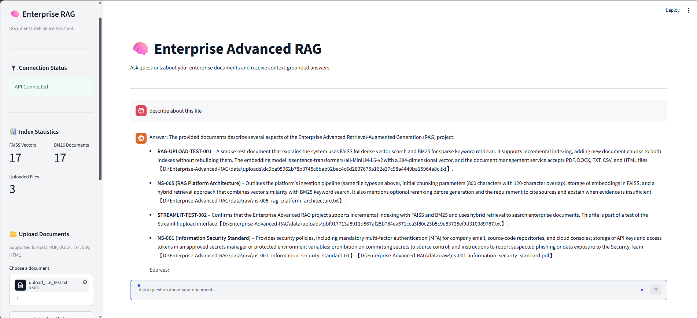
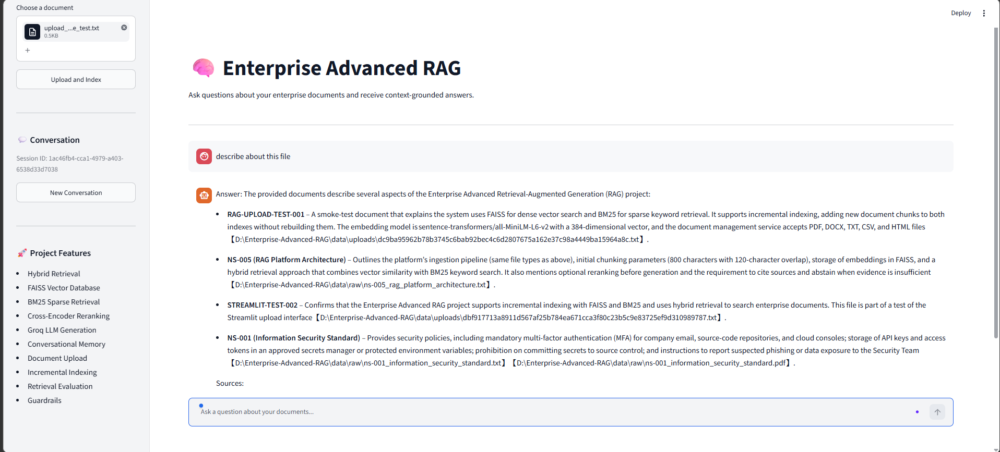

# Enterprise Advanced RAG System

<p align="center">
  <b>Building an Intelligent Enterprise Document Question-Answering System Using Hybrid Retrieval and Generative AI</b>
</p>

<p align="center">
  <a href="https://github.com/Ravinuthala-Venkata-Siva-Prasad/Enterprise-Advanced-RAG">GitHub Repository</a> •
  <a href="http://localhost:8501">Streamlit Application</a> •
  <a href="http://localhost:8000/docs">FastAPI Documentation</a>
</p>

<p align="center">
  
  
  
  
  
  
  
</p>

---

## 1. Project Overview

**Enterprise Advanced RAG** is an end-to-end Retrieval-Augmented Generation application that enables users to upload enterprise documents, search information, and receive context-grounded answers through a conversational interface.

Traditional LLM applications can generate answers without access to an organization's private documents. This project addresses that limitation by implementing a document retrieval pipeline that retrieves relevant information before generating responses.

The system combines:

- Dense vector retrieval using FAISS.
- Sparse keyword retrieval using BM25.
- Reciprocal Rank Fusion (RRF).
- Cross-Encoder reranking.
- Groq-powered LLM response generation.
- Source attribution and answer evaluation.
- Conversational memory and document management.

The application supports multiple document formats and provides both a Streamlit frontend and a FastAPI backend.

## 2. What I Built

I implemented the complete RAG workflow, from document ingestion to answer generation and evaluation.

| Module | What I implemented |
|---|---|
| Document ingestion | PDF, DOCX, TXT, CSV and HTML loaders |
| Document processing | Text cleaning, parsing and chunking |
| Embeddings | Sentence Transformer embedding generation |
| Vector storage | FAISS indexing and similarity search |
| Sparse retrieval | BM25 keyword-based retrieval |
| Hybrid retrieval | Dense and sparse result fusion using RRF |
| Reranking | Cross-Encoder relevance scoring |
| Deduplication | Removal of highly similar retrieved passages |
| LLM generation | Groq-based context-grounded responses |
| Guardrails | Input validation, injection detection and output checks |
| Conversational memory | SQLite session-based conversation storage |
| Query rewriting | Context-aware conversational query rewriting |
| Document management | Upload, list, inspect and delete documents |
| Backend | REST API using FastAPI |
| Frontend | Interactive application using Streamlit |
| Evaluation | Retrieval metrics and answer-quality metrics |

## 3. Application Screenshots

### Enterprise RAG Dashboard

The dashboard provides API connection status, FAISS and BM25 statistics, document management and the conversational question-answering interface.



### Document Upload and RAG Chat

Users can upload enterprise documents and ask questions. The system retrieves supporting content and generates answers with document source references.



### FastAPI Swagger Documentation

The backend exposes REST endpoints for chat, document uploads, document management and session operations.


## 4. System Architecture

```text
                   USER
                     |
                     v
              STREAMLIT FRONTEND
                     |
                     v
                FASTAPI BACKEND
                     |
                     v
             CONVERSATIONAL RAG
                     |
             +-------+-------+
             |               |
             v               v
       QUERY REWRITING   SQLITE MEMORY
             |
             v
        HYBRID RETRIEVAL
             |
       +-----+-----+
       |           |
       v           v
     FAISS        BM25
     DENSE       SPARSE
       |           |
       +-----+-----+
             |
             v
          RRF FUSION
             |
             v
      CROSS-ENCODER
        RERANKING
             |
             v
       DEDUPLICATION
             |
             v
       CONTEXT BUILDER
             |
             v
          GROQ LLM
             |
             v
      ANSWER + SOURCES
             |
             v
            USER
```

### Retrieval Workflow

1. The user submits a question.
2. The system processes the query and uses conversation history when applicable.
3. FAISS retrieves semantically similar document chunks.
4. BM25 retrieves keyword-relevant document chunks.
5. RRF combines the dense and sparse rankings.
6. A Cross-Encoder reranks the candidate passages.
7. Similar passages are removed through deduplication.
8. The context builder prepares the retrieved evidence.
9. Groq generates an answer using the supplied context.
10. The response includes source references and is processed through the configured guardrails.

## 5. Technology Stack

| Category | Technology |
|---|---|
| Programming | Python 3.11 |
| LLM Provider | Groq |
| LLM Model | openai/gpt-oss-120b |
| Embedding Model | sentence-transformers/all-MiniLM-L6-v2 |
| Vector Database | FAISS |
| Sparse Retrieval | BM25 |
| Hybrid Ranking | Reciprocal Rank Fusion |
| Reranking | Cross-Encoder |
| Backend | FastAPI |
| Frontend | Streamlit |
| Conversation Storage | SQLite |
| Configuration | YAML |
| Testing | Pytest |
| Version Control | Git and GitHub |

## 6. Project Structure

```text
Enterprise-Advanced-RAG/
│
├── api/
│   ├── bootstrap.py
│   ├── dependencies.py
│   ├── main.py
│   └── schemas.py
│
├── config/
│   ├── config.yaml
│   ├── conversation_config.yaml
│   ├── generation_config.yaml
│   ├── guardrails_config.yaml
│   ├── logging_config.yaml
│   ├── model_config.yaml
│   └── retrieval_config.yaml
│
├── data/
│   ├── raw/
│   ├── processed/
│   ├── embeddings/
│   ├── vectorstore/
│   ├── evaluation/
│   ├── conversations/
│   └── uploads/
│
├── deployment/
│
├── docs/
│   └── images/
│       ├── dashboard-overview.png
│       ├── document-upload-and-chat.png
│       └── fastapi-swagger-api.png
│
├── frontend/
│   ├── app.py
│   ├── api_client.py
│   └── config.py
│
├── notebooks/
│
├── reports/
│   └── evaluation/
│
├── scripts/
│   ├── ingest_documents.py
│   ├── chunk_documents.py
│   ├── generate_embeddings.py
│   ├── build_vectorstore.py
│   ├── run_answer_evaluation.py
│   └── run_retrieval_evaluation.py
│
├── src/
│   ├── document_management/
│   ├── embeddings/
│   ├── evaluation/
│   ├── generation/
│   ├── guardrails/
│   ├── ingestion/
│   ├── memory/
│   ├── parsing/
│   ├── pipeline/
│   ├── retrieval/
│   ├── utils/
│   └── vectorstores/
│
├── tests/
├── main.py
├── requirements.txt
├── .env.example
├── .gitignore
└── README.md
```

## 7. Installation and Setup

### Prerequisites

- Python 3.11
- Git
- Groq API key
- Internet connection for model downloads

### Step 1: Clone the repository

```powershell
git clone https://github.com/Ravinuthala-Venkata-Siva-Prasad/Enterprise-Advanced-RAG.git

cd Enterprise-Advanced-RAG
```

### Step 2: Create a virtual environment

```powershell
python -m venv .venv
```

### Step 3: Activate the environment

```powershell
.\.venv\Scripts\Activate.ps1
```

### Step 4: Install dependencies

```powershell
python -m pip install --upgrade pip

pip install -r requirements.txt
```

### Step 5: Configure environment variables

Create a `.env` file in the project root.

```env
GROQ_API_KEY=your_groq_api_key
```

Use the variable names required by your application configuration.

Never upload `.env` or API credentials to GitHub.

## 8. Run the Application

### Start the FastAPI backend

```powershell
uvicorn api.main:build_production_app --factory --host 127.0.0.1 --port 8000
```

### Start the Streamlit frontend

Open another terminal:

```powershell
.\.venv\Scripts\Activate.ps1

streamlit run frontend/app.py
```

### Application URLs

| Service | URL |
|---|---|
| Streamlit Frontend | http://localhost:8501 |
| FastAPI Backend | http://127.0.0.1:8000 |
| API Health Check | http://127.0.0.1:8000/health |
| Swagger Documentation | http://127.0.0.1:8000/docs |

## 9. API Endpoints

| Method | Endpoint | Description |
|---|---|---|
| GET | `/health` | API health check |
| POST | `/api/v1/chat` | Submit a RAG question |
| DELETE | `/api/v1/sessions/{session_id}` | Clear conversation history |
| POST | `/api/v1/documents/upload` | Upload and index a document |
| GET | `/api/v1/documents` | List registered documents |
| GET | `/api/v1/documents/stats` | Document and indexing statistics |
| GET | `/api/v1/documents/{document_id}` | Retrieve document details |
| DELETE | `/api/v1/documents/{document_id}` | Delete a registered document |

Interactive documentation is available at:

http://127.0.0.1:8000/docs

## 10. Evaluation and Benchmark Results

Evaluation is an important part of this project. I implemented separate evaluation workflows for retrieval quality and generated answer quality.

The current synthetic evaluation dataset contains four questions:

| Test ID | Question Category | Expected Behaviour |
|---|---|---|
| Q001 | Information Security / MFA | Retrieve policy and answer |
| Q002 | Remote Work Policy | Retrieve policy and answer |
| Q003 | Business Expense Policy | Retrieve policy and answer |
| RET-004 | Employee Bonus Percentage | Abstain because information is unavailable |

### A. Retrieval Evaluation

The retrieval evaluator measures whether the system retrieves relevant documents and ranks them correctly.

Implemented metrics:

- Precision@K
- Recall@K
- Hit Rate@K
- Mean Reciprocal Rank (MRR)
- Normalized Discounted Cumulative Gain (NDCG)

**Recorded retrieval benchmark:**

| Metric | Result |
|---|---:|
| Precision@1 | 1.0000 |
| Recall@1 | 0.5000 |
| Hit Rate@1 | 1.0000 |
| NDCG@1 | 1.0000 |
| Precision@3 | 0.6667 |
| Recall@3 | 1.0000 |
| Hit Rate@3 | 1.0000 |
| NDCG@3 | 0.9732 |
| Precision@5 | 0.4000 |
| Recall@5 | 1.0000 |
| Hit Rate@5 | 1.0000 |
| NDCG@5 | 0.9732 |
| MRR | 1.0000 |

These values are from the recorded retrieval evaluation run on November 21, 2026.

### B. Answer Evaluation

The answer evaluator measures generated answer quality against reference answers and retrieved evidence.

Implemented metrics:

- Token F1
- ROUGE-L F1
- Lexical Faithfulness
- Lexical Answer Relevancy
- Citation Precision
- Citation Recall
- Abstention Correctness
- Unsupported Answer Rate

**Latest recorded answer benchmark: November 21, 2026**

| Metric | Result |
|---|---:|
| Token F1 | 0.4171 |
| ROUGE-L F1 | 0.3950 |
| Lexical Faithfulness | 0.6964 |
| Lexical Answer Relevancy | 0.0934 |
| Citation Precision | 0.4000 |
| Citation Recall | 0.6250 |
| Abstention Correctness | 1.0000 |
| Unsupported Answer Rate | 0.0000 |

### C. Evaluation Execution Results

| Evaluation Status | Count |
|---|---:|
| Total Questions | 4 |
| Successfully Evaluated | 4 |
| Failed Evaluations | 0 |
| Answerable Questions | 3 |
| Unanswerable Questions | 1 |

### D. What the Evaluation Demonstrates

The recorded results demonstrate that:

1. The retrieval evaluator can identify relevant sources at the top ranking positions for the tested questions.
2. The system generated answers for the three answerable policy questions.
3. The system correctly abstained when asked about an employee bonus percentage that was not available in the documents.
4. The evaluation framework produces measurable retrieval and answer-quality reports.
5. The results also expose areas requiring improvement, especially citation matching, answer relevancy and retrieval precision at larger K values.

### E. Evaluation Limitations

The current evaluation dataset contains only four synthetic questions. Therefore, these results should be considered preliminary rather than production-level performance.

Additional limitations:

- Lexical faithfulness is not equivalent to semantic entailment or independently verified factual correctness.
- Citation precision and recall depend on the evaluator's source-matching rules and canonical document identity.
- Retrieval precision decreases as more candidate documents are included.
- More independently labelled questions are needed to establish reliable general performance.

### F. Generated Evaluation Reports

The evaluation scripts generate JSON and CSV reports.

```text
reports/
└── evaluation/
    ├── evaluation_20261121_105422.json
    ├── evaluation_20261121_105422.csv
    ├── retrieval_20261121_044725.json
    └── retrieval_20261121_044725.csv
```

Run answer evaluation:

```powershell
python scripts/run_answer_evaluation.py
```

Run retrieval evaluation:

```powershell
python scripts/run_retrieval_evaluation.py
```

## 11. Automated Testing

The project includes automated tests for:

- Hybrid retrieval and reranking.
- Answer and retrieval evaluation.
- FastAPI endpoints.
- Document ingestion and parsing.
- Text chunking.
- Embedding generation.
- FAISS vector storage.
- Incremental indexing.
- Guardrails.
- Conversational memory.
- Document management.
- Duplicate passage handling.

Run all tests:

```powershell
pytest tests/ -v
```

**Latest recorded regression test result:**

```text
110 passed in 10.70s
```

This confirms that all 110 tests passed in the recorded test run on November 21, 2026.

## 12. Security and Engineering Considerations

- Environment variables are used for API credentials.
- Uploaded files are validated before processing.
- Input validation and prompt-injection checks are implemented.
- Source references are checked by guardrail components.
- Document indexing supports incremental updates.
- Session-based conversation history is stored in SQLite.

Before public deployment, additional authentication, authorization, monitoring and operational security controls should be implemented and validated.

## 13. Future Improvements

- Expand the evaluation dataset with independently verified questions and relevance labels.
- Improve canonical source identity and citation matching.
- Introduce semantic and claim-level factuality evaluation.
- Improve retrieval precision through larger-scale testing.
- Add production observability and performance monitoring.
- Strengthen authentication and role-based document access.
- Evaluate performance on larger enterprise document collections.

## 14. What I Learned

Through this project, I gained practical experience in:

- Designing an end-to-end RAG architecture.
- Combining semantic and keyword-based retrieval.
- Implementing Reciprocal Rank Fusion.
- Using Cross-Encoder models for reranking.
- Building document ingestion and indexing workflows.
- Connecting LLMs to retrieved enterprise knowledge.
- Implementing conversational memory and query rewriting.
- Building REST APIs with FastAPI.
- Developing interactive applications with Streamlit.
- Evaluating retrieval and generated answers using quantitative metrics.
- Writing automated tests and debugging integration issues.

## 15. Project Information

**Project:** Enterprise Advanced RAG System

**Focus:** Generative AI, Retrieval-Augmented Generation and Enterprise Document Intelligence

**GitHub Repository:**

https://github.com/Ravinuthala-Venkata-Siva-Prasad/Enterprise-Advanced-RAG

**Disclaimer:** The included enterprise policies and evaluation data are synthetic demonstration content and do not represent actual company policies.

---

<p align="center">
  <b>Enterprise Advanced RAG System</b><br/>
  Generative AI • RAG • Hybrid Search • FAISS • BM25 • Cross-Encoder • Groq • FastAPI • Streamlit
</p>
