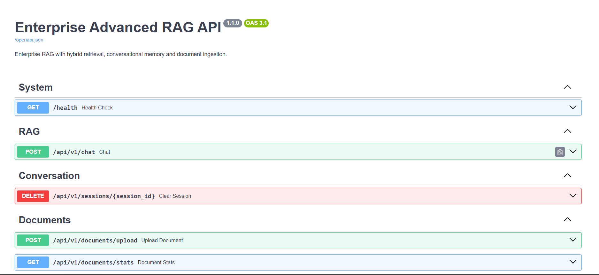
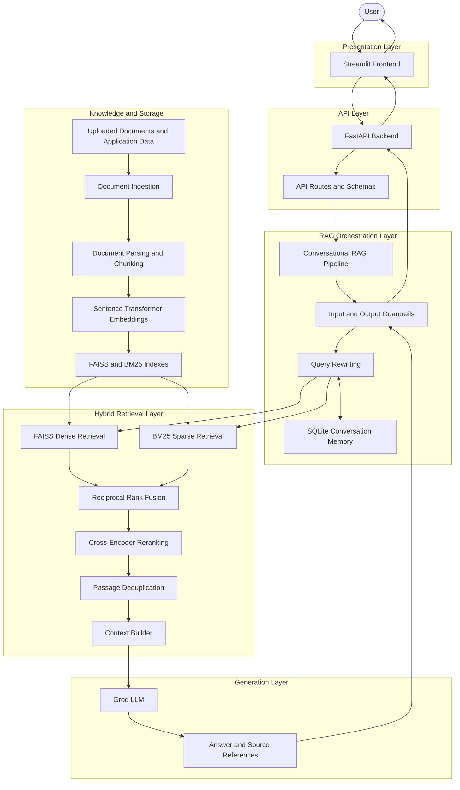
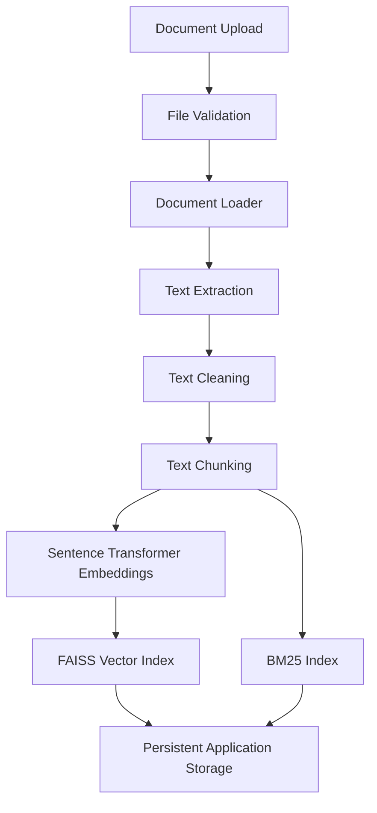
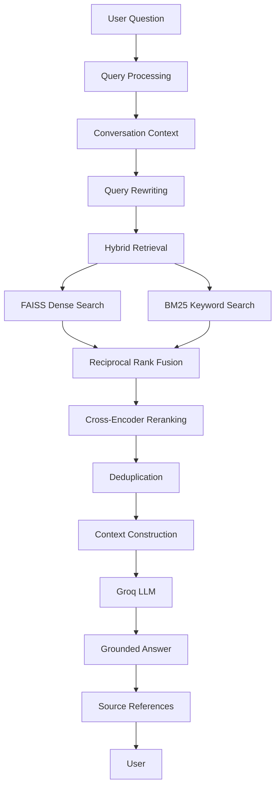
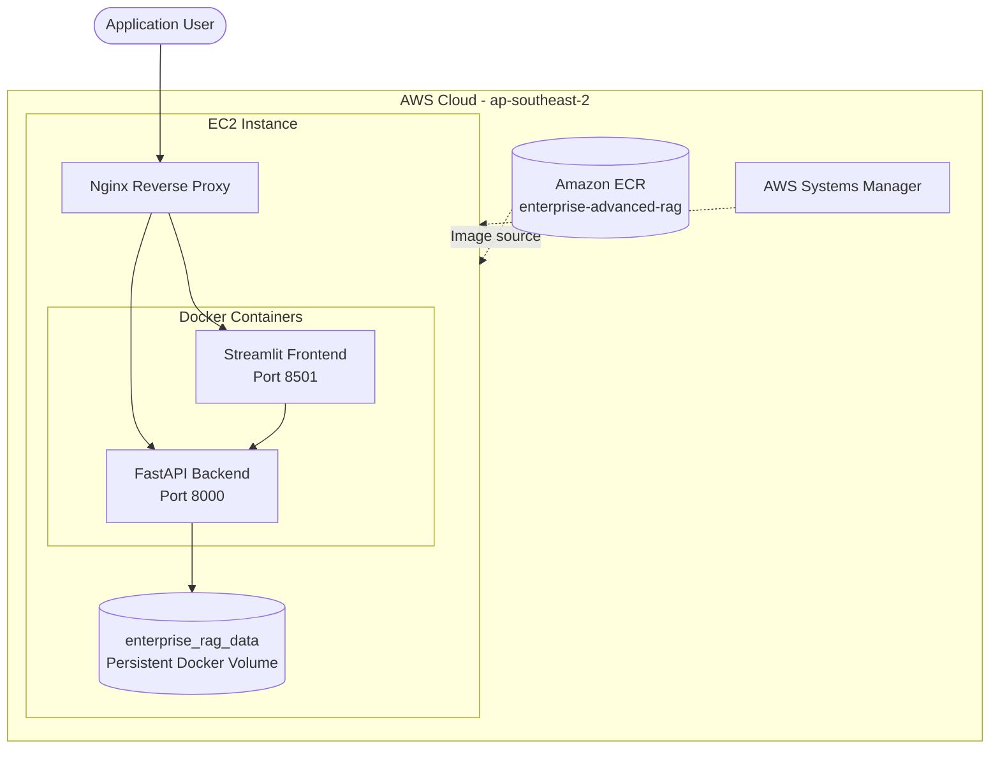
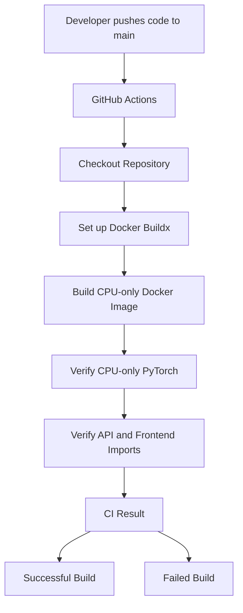
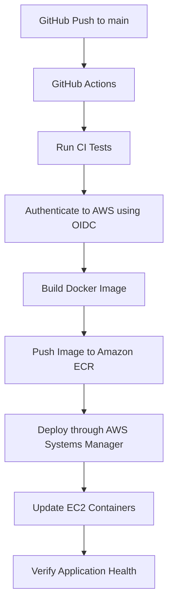

# Enterprise Advanced RAG
### AI-Powered Enterprise Document Intelligence Using Hybrid Retrieval and Generative AI

[](https://github.com/Ravinuthala-Venkata-Siva-Prasad/Enterprise-Advanced-RAG/actions)
[](https://www.python.org/)
[](https://fastapi.tiangolo.com/)
[](https://streamlit.io/)
[](https://www.docker.com/)
[](https://aws.amazon.com/)
[](LICENSE)

**Enterprise Advanced RAG** is an end-to-end Retrieval-Augmented Generation platform designed to search enterprise documents and generate context-grounded answers with source references.

The system combines dense vector search, sparse keyword retrieval, Reciprocal Rank Fusion, Cross-Encoder reranking, and Groq-powered LLM generation to improve document question answering.

| Resource | Link |
|---|---|
| GitHub Repository | [Enterprise Advanced RAG](https://github.com/Ravinuthala-Venkata-Siva-Prasad/Enterprise-Advanced-RAG) |
| Live Application | [Open RAG Application](http://3.27.213.85) |
| GitHub Actions | [CI Workflow](https://github.com/Ravinuthala-Venkata-Siva-Prasad/Enterprise-Advanced-RAG/actions) |
| License | [Apache 2.0](LICENSE) |

---

## Table of Contents

1. [Project Overview](#1-project-overview)
2. [Key Features](#2-key-features)
3. [Application Screenshots](#3-application-screenshots)
4. [System Architecture](#4-system-architecture)
5. [RAG Workflow](#5-rag-workflow)
6. [Technology Stack](#6-technology-stack)
7. [Project Structure](#7-project-structure)
8. [Installation and Setup](#8-installation-and-setup)
9. [Running the Application](#9-running-the-application)
10. [API Documentation](#10-api-documentation)
11. [Evaluation Framework](#11-evaluation-framework)
12. [Benchmark Results](#12-benchmark-results)
13. [Automated Testing](#13-automated-testing)
14. [Docker Deployment](#14-docker-deployment)
15. [AWS Deployment Architecture](#15-aws-deployment-architecture)
16. [GitHub Actions and CI/CD](#16-github-actions-and-cicd)
17. [Security and Engineering Considerations](#17-security-and-engineering-considerations)
18. [Limitations and Future Improvements](#18-limitations-and-future-improvements)
19. [What I Learned](#19-what-i-learned)
20. [License](#20-license)

---

## 1. Project Overview

Traditional LLM applications can generate answers without access to private organizational documents. Retrieval-Augmented Generation addresses this limitation by retrieving relevant information from a knowledge base before generating a response.

This project implements an enterprise-oriented RAG pipeline that allows users to:

- Upload documents in multiple formats.
- Extract and process document content.
- Generate embeddings and build a FAISS vector index.
- Retrieve information through semantic and keyword search.
- Combine retrieval results using Reciprocal Rank Fusion.
- Rerank retrieved passages using a Cross-Encoder.
- Generate context-grounded answers using Groq LLMs.
- View supporting document references.
- Maintain conversational history.
- Evaluate retrieval and answer quality.

### Main objectives

- Build a modular and maintainable RAG architecture.
- Improve retrieval through hybrid search.
- Improve context relevance through reranking.
- Generate answers grounded in retrieved evidence.
- Support document management and incremental indexing.
- Measure retrieval and answer quality through evaluation metrics.
- Deploy the application using Docker and AWS infrastructure.

---

## 2. Key Features

| Module | Implemented functionality |
|---|---|
| Document ingestion | PDF, DOCX, TXT, CSV and HTML |
| Document processing | Parsing, cleaning and chunking |
| Embeddings | Sentence Transformer embeddings |
| Vector retrieval | FAISS similarity search |
| Sparse retrieval | BM25 keyword search |
| Hybrid retrieval | Dense and sparse retrieval fusion |
| Ranking | Reciprocal Rank Fusion |
| Reranking | Cross-Encoder relevance scoring |
| Deduplication | Removal of highly similar passages |
| LLM generation | Groq-powered answer generation |
| Source attribution | Document source references |
| Guardrails | Input validation, injection detection and output checks |
| Conversational memory | SQLite session-based conversation storage |
| Query rewriting | Context-aware conversational query rewriting |
| Document management | Upload, list, inspect and delete |
| Backend | FastAPI REST API |
| Frontend | Streamlit interface |
| Evaluation | Retrieval and answer-quality metrics |
| Testing | Pytest automated tests |
| Containerization | Docker |
| Cloud deployment | AWS EC2 and Amazon ECR |

---

## 3. Application Screenshots

Add your actual application screenshots to `docs/images/` using the filenames below.

### 3.1 Enterprise RAG Dashboard

The dashboard provides API connection status, document statistics, FAISS and BM25 information, document management and conversational question answering.


### 3.2 Document Upload and RAG Chat

Users can upload documents and ask questions. The RAG pipeline retrieves relevant content and generates answers with source references.


### 3.3 FastAPI Swagger Documentation

The FastAPI backend exposes REST endpoints for chat, document uploads, document management and session operations.



---

## 4. System Architecture

The application follows a modular architecture separating the user interface, API, retrieval pipeline, document processing, storage and LLM generation.

### 4.1 High-Level Application Architecture



### 4.2 Document Ingestion Architecture



### 4.3 Query and Retrieval Architecture



---

## 5. RAG Workflow

The application follows these steps when answering a question.

1. The user submits a question through Streamlit.
2. Streamlit sends the request to the FastAPI backend.
3. The RAG pipeline processes the question.
4. Conversation history is considered when applicable.
5. Query rewriting improves contextual understanding.
6. FAISS performs semantic retrieval.
7. BM25 performs keyword-based retrieval.
8. Reciprocal Rank Fusion combines the retrieval rankings.
9. A Cross-Encoder reranks the retrieved passages.
10. Duplicate or highly similar passages are removed.
11. The context builder prepares the retrieved evidence.
12. The Groq LLM generates an answer using the available context.
13. Guardrails process the response.
14. The application returns the answer with source references.

### Retrieval strategy

**Dense retrieval — FAISS**

Uses vector embeddings to retrieve semantically similar document passages.

**Sparse retrieval — BM25**

Uses keyword relevance to retrieve passages matching the user's terminology.

**Hybrid retrieval — RRF**

Combines dense and sparse rankings to improve candidate retrieval.

**Cross-Encoder reranking**

Reevaluates retrieved question-passage pairs to improve relevance ordering.

---

## 6. Technology Stack

| Category | Technology |
|---|---|
| Programming language | Python 3.11 |
| LLM provider | Groq |
| LLM model | openai/gpt-oss-120b |
| Embedding model | sentence-transformers/all-MiniLM-L6-v2 |
| Vector database | FAISS |
| Sparse retrieval | BM25 |
| Hybrid ranking | Reciprocal Rank Fusion |
| Reranking | Cross-Encoder |
| Backend | FastAPI |
| Frontend | Streamlit |
| Conversation storage | SQLite |
| Configuration | YAML |
| Testing | Pytest |
| Containerization | Docker |
| Cloud platform | AWS |
| Container registry | Amazon ECR |
| Reverse proxy | Nginx |
| Version control | Git and GitHub |
| CI | GitHub Actions |

---

## 7. Project Structure

```text
Enterprise-Advanced-RAG/
│
├── .github/
│   └── workflows/
│
├── .streamlit/
│
├── api/
│   ├── bootstrap.py
│   ├── dependencies.py
│   ├── main.py
│   └── schemas.py
│
├── config/
│   ├── config.yaml
│   ├── conversation_config.yaml
│   ├── generation_config.yaml
│   ├── guardrails_config.yaml
│   ├── logging_config.yaml
│   ├── model_config.yaml
│   └── retrieval_config.yaml
│
├── docs/
│   └── images/
│       ├── dashboard-overview.png
│       ├── document-upload-and-chat.png
│       └── fastapi-swagger-api.png
│
├── frontend/
│   ├── app.py
│   ├── api_client.py
│   └── config.py
│
├── reports/
│   └── evaluation/
│
├── scripts/
│   ├── ingest_documents.py
│   ├── chunk_documents.py
│   ├── generate_embeddings.py
│   ├── build_vectorstore.py
│   ├── run_answer_evaluation.py
│   └── run_retrieval_evaluation.py
│
├── src/
│   ├── document_management/
│   ├── embeddings/
│   ├── evaluation/
│   ├── generation/
│   ├── guardrails/
│   ├── ingestion/
│   ├── memory/
│   ├── parsing/
│   ├── pipeline/
│   ├── retrieval/
│   ├── utils/
│   └── vectorstores/
│
├── tests/
│
├── .dockerignore
├── .env.example
├── .gitignore
├── Dockerfile
├── Dockerfile.cpu
├── docker-compose.yml
├── main.py
├── requirements.txt
├── start.sh
├── LICENSE
└── README.md
```

---

## 8. Installation and Setup

### Prerequisites

- Python 3.11
- Git
- Groq API key
- Internet connection for model downloads

### Step 1: Clone the repository

```bash
git clone https://github.com/Ravinuthala-Venkata-Siva-Prasad/Enterprise-Advanced-RAG.git

cd Enterprise-Advanced-RAG
```

### Step 2: Create a virtual environment

```bash
python -m venv .venv
```

### Step 3: Activate the environment

**Windows PowerShell**

```powershell
.\.venv\Scripts\Activate.ps1
```

**Linux / macOS**

```bash
source .venv/bin/activate
```

### Step 4: Install dependencies

```bash
python -m pip install --upgrade pip

pip install -r requirements.txt
```

### Step 5: Configure environment variables

Create a `.env` file in the project root.

```env
GROQ_API_KEY=your_groq_api_key
```

Use any additional environment variables required by your application configuration.

**Important:** Never commit `.env`, API credentials, passwords or private deployment configuration to GitHub.

---

## 9. Running the Application

Run the backend and frontend in separate terminals.

### Terminal 1: FastAPI backend

```bash
uvicorn api.main:build_production_app --factory --host 127.0.0.1 --port 8000
```

### Terminal 2: Streamlit frontend

```bash
streamlit run frontend/app.py
```

### Local application URLs

| Service | URL |
|---|---|
| Streamlit frontend | http://localhost:8501 |
| FastAPI backend | http://127.0.0.1:8000 |
| API health | http://127.0.0.1:8000/health |
| Swagger documentation | http://127.0.0.1:8000/docs |

---

## 10. API Documentation

The FastAPI backend provides REST endpoints for conversational question answering and document management.

| Method | Endpoint | Description |
|---|---|---|
| GET | `/health` | API health check |
| POST | `/api/v1/chat` | Submit a RAG question |
| DELETE | `/api/v1/sessions/{session_id}` | Clear conversation history |
| POST | `/api/v1/documents/upload` | Upload and index a document |
| GET | `/api/v1/documents` | List registered documents |
| GET | `/api/v1/documents/stats` | Document and indexing statistics |
| GET | `/api/v1/documents/{document_id}` | Retrieve document details |
| DELETE | `/api/v1/documents/{document_id}` | Delete a registered document |

### Swagger API documentation

When running locally:

```text
http://127.0.0.1:8000/docs
```

The public API documentation route should be published only after the reverse-proxy route is configured and verified.

---

## 11. Evaluation Framework

The project implements separate evaluation workflows for retrieval quality and generated answer quality.

### Retrieval evaluation

Measures whether relevant document passages are retrieved and ranked correctly.

Implemented metrics:

- Precision@K
- Recall@K
- Hit Rate@K
- Mean Reciprocal Rank (MRR)
- Normalized Discounted Cumulative Gain (NDCG)

### Answer evaluation

Measures generated answer quality against reference answers and retrieved evidence.

Implemented metrics:

- Token F1
- ROUGE-L F1
- Lexical Faithfulness
- Lexical Answer Relevancy
- Citation Precision
- Citation Recall
- Abstention Correctness
- Unsupported Answer Rate

### Evaluation dataset

The recorded synthetic evaluation dataset contains four questions.

| Test ID | Category | Expected behaviour |
|---|---|---|
| Q001 | Information Security / MFA | Retrieve policy and answer |
| Q002 | Remote Work Policy | Retrieve policy and answer |
| Q003 | Business Expense Policy | Retrieve policy and answer |
| RET-004 | Employee Bonus Percentage | Abstain because information is unavailable |

---

## 12. Benchmark Results

The following results are taken from the recorded evaluation reports in the repository. They are preliminary results, not independently validated production benchmarks.

### 12.1 Retrieval evaluation

Recorded run: November 21, 2026.

| Metric | Result |
|---|---:|
| Precision@1 | 1.0000 |
| Recall@1 | 0.5000 |
| Hit Rate@1 | 1.0000 |
| NDCG@1 | 1.0000 |
| Precision@3 | 0.6667 |
| Recall@3 | 1.0000 |
| Hit Rate@3 | 1.0000 |
| NDCG@3 | 0.9732 |
| Precision@5 | 0.4000 |
| Recall@5 | 1.0000 |
| Hit Rate@5 | 1.0000 |
| NDCG@5 | 0.9732 |
| MRR | 1.0000 |

### 12.2 Answer evaluation

Recorded run: November 21, 2026.

| Metric | Result |
|---|---:|
| Token F1 | 0.4171 |
| ROUGE-L F1 | 0.3950 |
| Lexical Faithfulness | 0.6964 |
| Lexical Answer Relevancy | 0.0934 |
| Citation Precision | 0.4000 |
| Citation Recall | 0.6250 |
| Abstention Correctness | 1.0000 |
| Unsupported Answer Rate | 0.0000 |

### 12.3 Evaluation execution

| Evaluation status | Count |
|---|---:|
| Total questions | 4 |
| Successfully evaluated | 4 |
| Failed evaluations | 0 |
| Answerable questions | 3 |
| Unanswerable questions | 1 |

### 12.4 What the results demonstrate

The recorded evaluation demonstrates that:

1. The retrieval evaluator can identify relevant sources at top ranking positions for the tested questions.
2. The system generated answers for three answerable policy questions.
3. The system correctly abstained when the requested bonus percentage was unavailable.
4. The evaluation framework generates measurable retrieval and answer-quality reports.
5. The results identify improvements needed in citation matching, answer relevancy and retrieval precision at larger K values.

### 12.5 Evaluation limitations

The evaluation dataset contains only four synthetic questions. Consequently, these results should be considered preliminary rather than evidence of production-level accuracy.

Additional limitations:

- Lexical faithfulness does not establish semantic entailment or factual correctness.
- Citation precision and recall depend on source-matching rules.
- Retrieval precision decreases as more candidate documents are included.
- A larger independently labelled evaluation dataset is required for reliable general performance.

### 12.6 Generated evaluation reports

The repository includes recorded JSON and CSV evaluation reports.

```text
reports/
└── evaluation/
    ├── evaluation_20261121_105422.json
    ├── evaluation_20261121_105422.csv
    ├── retrieval_20261121_044725.json
    └── retrieval_20261121_044725.csv
```

Run answer evaluation:

```bash
python scripts/run_answer_evaluation.py
```

Run retrieval evaluation:

```bash
python scripts/run_retrieval_evaluation.py
```

---

## 13. Automated Testing

The project includes automated tests covering:

- Hybrid retrieval and reranking.
- Answer and retrieval evaluation.
- FastAPI endpoints.
- Document ingestion and parsing.
- Text chunking.
- Embedding generation.
- FAISS vector storage.
- Incremental indexing.
- Guardrails.
- Conversational memory.
- Document management.
- Duplicate passage handling.

Run tests:

```bash
pytest tests/ -v
```

### Recorded regression test result

```text
110 passed in 10.70s
```

This result is from the recorded November 21, 2026 test run. It should not be interpreted as the result of every subsequent code change.

---

## 14. Docker Deployment

The project includes Docker configurations for containerized execution.

### Docker files

| File | Purpose |
|---|---|
| `Dockerfile` | Main Docker image configuration |
| `Dockerfile.cpu` | CPU-only Docker image configuration |
| `docker-compose.yml` | Docker Compose configuration |

### Build CPU-only image

```bash
docker build -f Dockerfile.cpu -t enterprise-advanced-rag:latest .
```

### Run the image

Use the environment file and persistent data volume required by your deployment.

```bash
docker run -d \
  --name enterprise-rag-api \
  --env-file .env \
  -v enterprise_rag_data:/app/data \
  -p 127.0.0.1:8000:8000 \
  enterprise-advanced-rag:latest \
  uvicorn api.main:build_production_app \
  --factory --host 0.0.0.0 --port 8000
```

The frontend is run as a separate container in the deployed architecture.

**Note:** The commands above illustrate the API container setup. For an existing deployment, preserve its actual environment configuration, container networking and volume settings rather than replacing containers blindly.

---

## 15. AWS Deployment Architecture

The application is currently deployed on AWS EC2 using Docker containers and Amazon ECR.

### 15.1 Deployed infrastructure

| Component | Technology |
|---|---|
| Cloud platform | AWS |
| Compute | EC2 |
| Container registry | Amazon ECR |
| Container runtime | Docker |
| Reverse proxy | Nginx |
| Backend | FastAPI |
| Frontend | Streamlit |
| Persistent storage | Docker named volume |
| Remote management | AWS Systems Manager |

### 15.2 Deployment architecture



### 15.3 Current application containers

| Container | Function |
|---|---|
| `enterprise-rag-api` | FastAPI backend |
| `enterprise-rag-frontend` | Streamlit interface |

Both containers currently use the same ECR image:

```text
316992254617.dkr.ecr.ap-southeast-2.amazonaws.com/enterprise-advanced-rag:v2
```

The API container uses the persistent Docker volume:

```text
enterprise_rag_data:/app/data
```

This volume preserves application data independently of container replacement.

### 15.4 Live application

```text
http://3.27.213.85
```

The live application is currently served over HTTP. HTTPS should be treated as enabled only after the production certificate and Nginx configuration have been verified.

---

## 16. GitHub Actions and CI/CD

The repository contains a GitHub Actions workflow named:

**Enterprise Advanced RAG CI**

The existing CI workflow performs:

1. Repository checkout.
2. Docker Buildx setup.
3. CPU-only Docker image build.
4. PyTorch CPU-only verification.
5. API and frontend import verification.

### CI workflow



### Current CI status

The repository has recorded five successful workflow runs as of November 22, 2026.

The current workflow builds and tests the Docker image. Automated ECR publishing and EC2 deployment are being configured separately.

### Planned deployment automation

The intended deployment workflow is:



This is the planned CI/CD architecture, not a claim that automatic deployment is already complete.

---

## 17. Security and Engineering Considerations

The project implements several application-level safeguards:

- Environment variables for API credentials.
- Uploaded file validation.
- Input validation.
- Prompt-injection checks.
- Output checks.
- Source reference validation.
- Incremental document indexing.
- Session-based conversation storage in SQLite.

### Deployment security considerations

Additional controls that should be implemented and validated before treating the application as a production enterprise service include:

- Authentication and authorization.
- Role-based document access.
- Secure secret management.
- HTTPS and certificate renewal verification.
- Network access restrictions.
- Centralized logging and monitoring.
- Deployment rollback procedures.
- Resource and upload limits.

---

## 18. Limitations and Future Improvements

### Current limitations

- Evaluation dataset contains only four synthetic questions.
- Citation matching requires further improvement.
- Answer relevancy requires improvement.
- Retrieval precision needs further testing at larger K values.
- Enterprise authentication and authorization require further implementation and validation.
- Production observability and operational monitoring need further development.

### Planned improvements

- Expand evaluation with independently verified questions.
- Improve canonical document identity and citation matching.
- Add semantic and claim-level factuality evaluation.
- Improve retrieval precision through larger-scale testing.
- Implement production monitoring and observability.
- Strengthen authentication and role-based document access.
- Evaluate performance on larger enterprise document collections.
- Complete automated GitHub Actions deployment to AWS ECR and EC2.

---

## 19. What I Learned

Through this project, I gained practical experience in:

- Designing an end-to-end RAG architecture.
- Building document ingestion and indexing workflows.
- Combining dense and sparse retrieval.
- Implementing Reciprocal Rank Fusion.
- Using Cross-Encoder models for reranking.
- Connecting LLMs to retrieved enterprise knowledge.
- Implementing conversational memory and query rewriting.
- Building REST APIs using FastAPI.
- Developing interactive applications using Streamlit.
- Evaluating retrieval and generated answers using quantitative metrics.
- Writing automated tests and debugging integration issues.
- Containerizing applications with Docker.
- Deploying applications on AWS EC2 and Amazon ECR.
- Managing application data with persistent Docker volumes.
- Using GitHub Actions for automated CI.

---

## 20. License

This project is licensed under the Apache License 2.0.

See the [LICENSE](LICENSE) file for details.

---

## Project Information

**Project:** Enterprise Advanced RAG System

**Focus:** Generative AI, Retrieval-Augmented Generation, Hybrid Search and Enterprise Document Intelligence

**Developer:** Ravinuthala Venkata Siva Prasad

**GitHub Repository:**

https://github.com/Ravinuthala-Venkata-Siva-Prasad/Enterprise-Advanced-RAG

**Live Application:**

http://3.27.213.85

---

**Disclaimer:** The enterprise policies and evaluation data included in this project are synthetic demonstration content. They do not represent actual company policies or confidential enterprise information.

---

*Enterprise Advanced RAG — Generative AI • RAG • Hybrid Search • FAISS • BM25 • Cross-Encoder • Groq • FastAPI • Streamlit • Docker • AWS*
